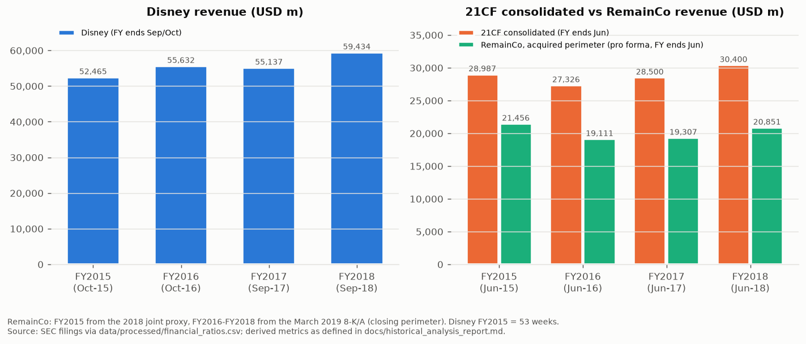
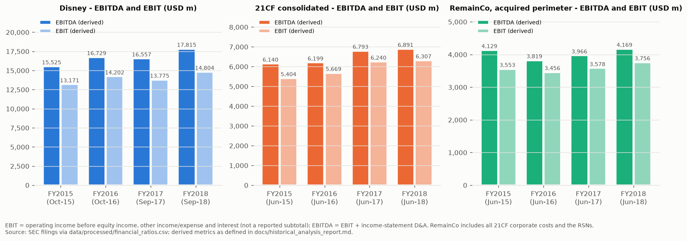
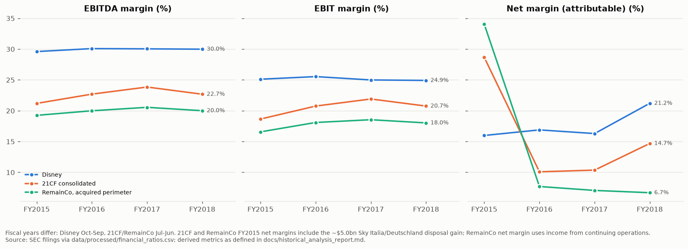
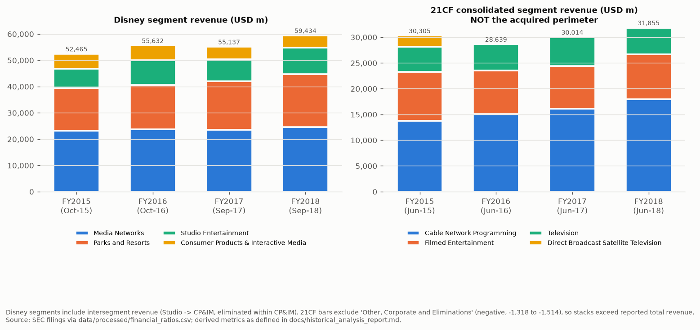
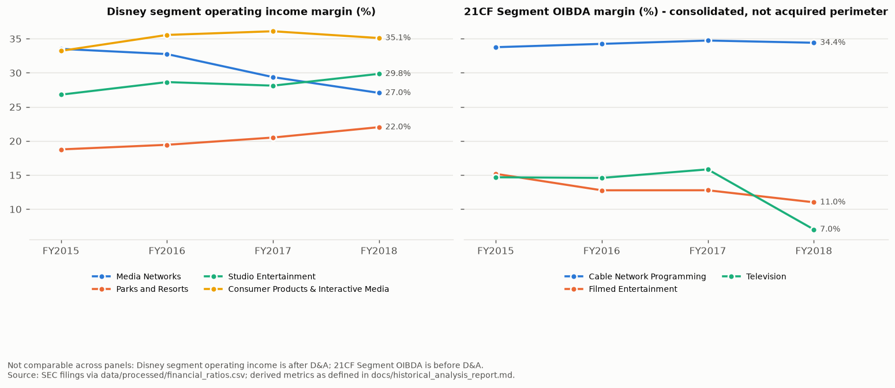
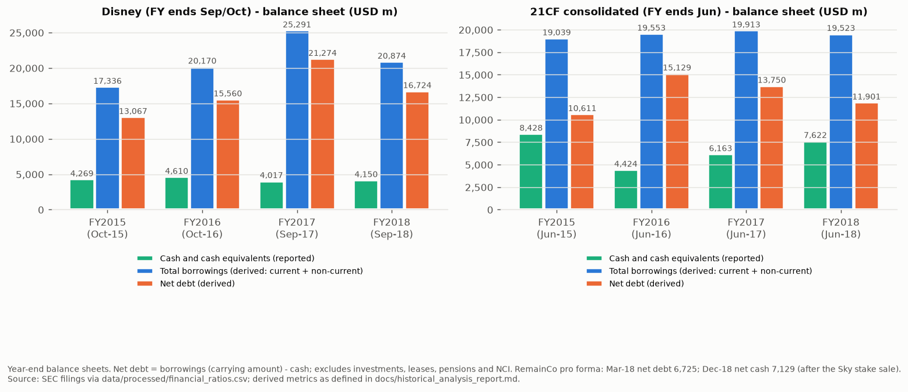
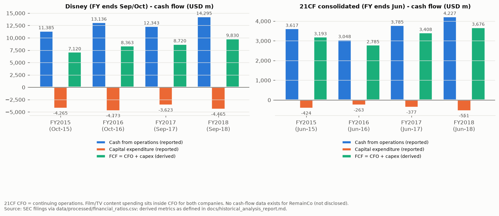

# Historical financial analysis: Disney / 21st Century Fox (Stage 2)

*Built only from the verified data layer (`historical_financials.csv`). No valuation.*
Rebuild: `python src/build_analysis.py && python src/make_charts.py`. Walkthrough: `notebooks/02_historical_analysis.ipynb`.

## How to read this report

* **Units:** USD millions unless shown as %, x or USD per share.
* **Labels:** **R** = reported (unchanged from the filing) · **D** = derived (formula on reported figures) ·
  **A** = adjusted (derived, excluding restructuring/impairment) · **n/a** = not available (reason given). No estimates.
* **Traceability:** every value is a row in `data/processed/financial_ratios.csv` or `segment_analysis.csv`. The
  `inputs` column lists each input as `name=value [record_id; source_id p.page]`. Primary sources: Disney FY2017 10-K
  (`DIS_10K_FY2017`, income statement p.58, balance sheet p.60, cash flow p.61, segments pp.65-66) and
  FY2018 10-K (`DIS_10K_FY2018`, pp.62-70); 21CF FY2017 10-K (`FOX_10K_FY2017`, pp.68-71, segments p.120) and
  FY2018 10-K (`FOX_10K_FY2018`, pp.79-82, segments p.135); FY2015 balance sheets from the FY2016 10-Ks; RemainCo
  from the 2018 joint proxy (`JPROXY_AMENDED_20180628`, pp.285-289) and the March 2019 8-K/A (`DIS_8KA_20190327_EX99_4`, pp.3-7).
* **Fiscal years are not aligned.** Disney: Oct–Sep (FY2015 = 53 weeks, ending 3 Oct 2015). 21CF and RemainCo: Jul–Jun.
  Disney FY2017 and 21CF FY2017 overlap by nine months. No calendarisation has been applied.

### Definitions (derived)

| Metric | Formula | Comparability note |
|---|---|---|
| EBIT (D) | Disney: revenue + total costs and expenses + restructuring/impairment. 21CF/RemainCo: revenue + operating expenses + SG&A + D&A + impairment/restructuring | Operating income before equity income, other income/expense and interest. Neither company reports this subtotal. |
| EBITDA (D) | EBIT + income-statement D&A | 21CF's amortization of cable distribution investments is *not* added back. |
| EBITDA excl. restructuring (A) | EBITDA − restructuring/impairment line | |
| Gross margin excl. D&A (D) | Disney: revenue + cost of services + cost of products. 21CF: revenue + operating expenses | **Not comparable** between the companies (different cost scopes). 21CF FY2018 is on its FY2018 10-K basis, after a reclassification from SG&A to opex. |
| Effective tax rate (D) | −income tax / pretax income from continuing operations | |
| ROA, ROE (D) | Net income attributable ÷ average total assets / average parent equity | FY2014 opening balances come from the FY2015 10-K comparatives (not primary values). |
| Total borrowings, net debt (D) | Current + non-current borrowings; minus cash | Carrying amounts. Excludes investments, leases, pensions and NCI. |
| Working capital (D) | Current assets − current liabilities; also shown excluding cash and current borrowings | |
| FCF (D) | Cash from operations + capex (capex is negative) | Not a company-defined measure. Film/TV content spend sits inside CFO for both. 21CF CFO = continuing operations. |

---

## 1. Historical performance

### Revenue (R) and growth (D)

| | FY2015 | FY2016 | FY2017 | FY2018 | CAGR FY15–17 | CAGR FY15–18 |
|---|---|---|---|---|---|---|
| Disney revenue | 52,465 | 55,632 | 55,137 | 59,434 | 2.5% | 4.2% |
| Disney YoY | | 6.0% | −0.9% | 7.8% | | |
| 21CF revenue (consolidated) | 28,987 | 27,326 | 28,500 | 30,400 | −0.8% | 1.6% |
| 21CF YoY | | −5.7% | 4.3% | 6.7% | | |
| RemainCo revenue (pro forma) | 21,456 | 19,111 | 19,307 | 20,851 | | |

* **Disney** grew slowly. Reported FY2016 growth of 6.0% *understates* underlying growth, because FY2015 had 53 weeks
  and FY2016 had 52. The extra week is not quantified in the data. FY2017 was flat (Studio and Consumer Products down, Parks up). FY2018 rose 7.8%.
* **21CF** fell in FY2016 because the Direct Broadcast Satellite businesses (Sky Italia, Sky Deutschland) were sold in
  Nov 2014: DBS segment revenue was 2,112 in FY2015 and 0 afterwards (R, `FOX_10K_FY2017` p.120). Excluding that
  disposal, revenue grew every year.
* **RemainCo** is 66–74% of 21CF revenue (D). It fell 10.9% from FY2015 to FY2016. FY2015 RemainCo revenue very
  likely includes the DBS businesses, which were not New Fox businesses, but the proxy gives no breakdown that
  confirms this.

### Profitability

| % unless stated | | FY2015 | FY2016 | FY2017 | FY2018 |
|---|---|---|---|---|---|
| EBITDA (D, USD m) | Disney | 15,525 | 16,729 | 16,557 | 17,815 |
| | 21CF | 6,140 | 6,199 | 6,793 | 6,891 |
| EBITDA margin (D) | Disney | 29.6 | 30.1 | 30.0 | 30.0 |
| | 21CF | 21.2 | 22.7 | 23.8 | 22.7 |
| EBITDA margin excl. restructuring (A) | Disney | 29.7 | 30.4 | 30.2 | 30.0 |
| | 21CF | 22.9 | 23.9 | 24.9 | 22.9 |
| EBIT margin (D) | Disney | 25.1 | 25.5 | 25.0 | 24.9 |
| | 21CF | 18.6 | 20.7 | 21.9 | 20.7 |
| Gross margin excl. D&A (D, not comparable) | Disney | 45.9 | 46.1 | 45.0 | 44.9 |
| | 21CF | 36.0 | 37.3 | 37.6 | 35.0 |
| Net margin, attributable (D) | Disney | 16.0 | 16.9 | 16.3 | 21.2 |
| | 21CF | 28.7 | 10.1 | 10.4 | 14.7 |
| Effective tax rate (D) | Disney | 36.2 | 34.2 | 32.1 | 11.3 |
| | 21CF | 12.6 | 27.2 | 30.3 | −8.3 |
| ROA, average assets (D) | Disney | 9.7 | 10.4 | 9.6 | 13.0 |
| | 21CF | 15.8 | 5.6 | 6.0 | 8.5 |
| ROE, average parent equity (D) | Disney | 18.7 | 21.4 | 21.2 | 28.0 |
| | 21CF | 48.0 | 17.8 | 20.1 | 25.3 |

What drives these numbers:
* **Disney's operating margins are stable at about 30% EBITDA and 25% EBIT**, with a slow mix shift: Media Networks
  margins fall while Parks margins rise (§2).
* **21CF's EBITDA margin rose from 21% to 24% (FY15–FY17), then slipped to 22.7% in FY2018**, as Television OIBDA fell
  from 894 to 362 (§2).
* **The FY2015 net margin, ETR and returns for 21CF are distorted** by a ~$5.0bn pre-tax gain on the Sky
  Italia/Deutschland sale, recorded in "Other, net" (4,698; R). The tax on it was largely offset by capital-loss
  carryforwards and foreign tax credits (FY2017 10-K), which is why the FY2015 ETR is 12.6%.
* **FY2018 tax rates fall for both companies** with the December 2017 US tax law: Disney 11.3%, 21CF −8.3% (a tax
  benefit). FY2018 net margins are therefore not representative of a normal year.
* **Disney's ROE is lifted by buybacks.** Treasury stock grew to −64,011 at FY2017 (R, p.60), which keeps book equity
  low.

---

## 2. Segments

### Disney (R; margins and shares D). Segment operating income is after D&A.

| | Revenue FY15 | FY16 | FY17 | FY18 | Margin FY15 | FY16 | FY17 | FY18 | Share of segment OI FY17 |
|---|---|---|---|---|---|---|---|---|---|
| Media Networks | 23,264 | 23,689 | 23,510 | 24,500 | 33.5% | 32.7% | 29.4% | 27.0% | 46.7% |
| Parks and Resorts | 16,162 | 16,974 | 18,415 | 20,296 | 18.8% | 19.4% | 20.5% | 22.0% | 25.5% |
| Studio Entertainment | 7,366 | 9,441 | 8,379 | 9,987 | 26.8% | 28.6% | 28.1% | 29.8% | 15.9% |
| Consumer Products & Interactive Media | 5,673 | 5,528 | 4,833 | 4,651 | 33.2% | 35.5% | 36.1% | 35.1% | 11.8% |
| **Total** | 52,465 | 55,632 | 55,137 | 59,434 | 28.0% | 28.3% | 26.8% | 26.4% | |

Source: `DIS_10K_FY2017` p.65 (FY2015–FY2017; four-segment comparatives); `DIS_10K_FY2018` p.69 (FY2018). Studio
revenue includes intersegment sales, which are eliminated within CP&IM.

* **Media Networks**, the profit engine at 47–53% of segment OI, saw its margin fall 6.5 points over FY15–FY18 while revenue was flat.
* **Parks and Resorts** is the growth driver: revenue CAGR FY15–FY18 is 7.9% (D from the table), and its margin
  rose 3.2 points.
* **Studio** results move with the film slate (FY2016 and FY2018 peaks).

### 21CF consolidated (R; margins and shares D). Segment OIBDA is before D&A, so these margins are not comparable to Disney's.

| | Revenue FY15 | FY16 | FY17 | FY18 | OIBDA margin FY15 | FY16 | FY17 | FY18 |
|---|---|---|---|---|---|---|---|---|
| Cable Network Programming | 13,773 | 15,029 | 16,130 | 17,946 | 33.7% | 34.2% | 34.7% | 34.4% |
| Filmed Entertainment | 9,525 | 8,505 | 8,235 | 8,747 | 15.2% | 12.8% | 12.8% | 11.0% |
| Television | 4,895 | 5,105 | 5,649 | 5,162 | 14.7% | 14.6% | 15.8% | 7.0% |
| Direct Broadcast Satellite TV | 2,112 | 0 | 0 | n/a | 11.1% | | | |
| Other, Corporate & Eliminations | (1,318) | (1,313) | (1,514) | (1,455) | | | | |
| **Total** | 28,987 | 27,326 | 28,500 | 30,400 | 23.2% | 24.1% | 25.2% | 23.1% |

Source: `FOX_10K_FY2017` p.120; `FOX_10K_FY2018` p.135.

> **These are not the acquired business's segments.** Cable Network Programming combines networks Disney bought (FX,
> National Geographic, the RSNs, Fox Networks Group International, Star India) with New Fox networks (Fox News, FBN,
> FS1/FS2, Big Ten Network). Television (FOX network and stations) is almost entirely New Fox. Filmed Entertainment
> is mostly acquired, but the studio lot went to New Fox. **No RemainCo segment data exists in the sources**, so
> `segment_analysis.csv` holds explicit `not_available` rows for it.

---

## 3. Balance sheet and cash flow

| | | FY2015 | FY2016 | FY2017 | FY2018 |
|---|---|---|---|---|---|
| Cash (R) | Disney | 4,269 | 4,610 | 4,017 | 4,150 |
| | 21CF | 8,428 | 4,424 | 6,163 | 7,622 |
| Total borrowings (D) | Disney | 17,336 | 20,170 | 25,291 | 20,874 |
| | 21CF | 19,039 | 19,553 | 19,913 | 19,523 |
| Net debt (D) | Disney | 13,067 | 15,560 | 21,274 | 16,724 |
| | 21CF | 10,611 | 15,129 | 13,750 | 11,901 |
| Total equity incl. NCI (R) | Disney | 48,655 | 47,323 | 45,004 | 52,832 |
| | 21CF | 18,186 | 14,881 | 16,938 | 20,798 |
| Working capital (D) | Disney | 424 | 124 | (3,706) | (1,035) |
| | 21CF | 10,306 | 7,881 | 9,048 | 11,089 |
| Debt / equity (D) | Disney | 0.36x | 0.43x | 0.56x | 0.40x |
| | 21CF | 1.05x | 1.31x | 1.18x | 0.94x |
| Net debt / EBITDA (D) | Disney | 0.84x | 0.93x | 1.28x | 0.94x |
| | 21CF | 1.73x | 2.44x | 2.02x | 1.73x |
| EBIT / net interest (D) | Disney | 112.6x | 54.6x | 35.8x | 25.8x |
| | 21CF | 4.5x | 4.8x | 5.1x | 5.1x |
| Cash from operations (R) | Disney | 11,385 | 13,136 | 12,343 | 14,295 |
| | 21CF (continuing) | 3,617 | 3,048 | 3,785 | 4,227 |
| Capex (R) | Disney | (4,265) | (4,773) | (3,623) | (4,465) |
| | 21CF | (424) | (263) | (377) | (551) |
| FCF = CFO + capex (D) | Disney | 7,120 | 8,363 | 8,720 | 9,830 |
| | 21CF | 3,193 | 2,785 | 3,408 | 3,676 |
| Capex / revenue (D) | Disney | 8.1% | 8.6% | 6.6% | 7.5% |
| | 21CF | 1.5% | 1.0% | 1.3% | 1.8% |
| CFO / EBITDA (D) | Disney | 0.73 | 0.79 | 0.75 | 0.80 |
| | 21CF | 0.59 | 0.49 | 0.56 | 0.61 |

* **Disney is lightly levered** (net debt / EBITDA ≤ 1.3x). Borrowings rose through FY2017, a year with share
  repurchases of 9,368 (R). Disney's interest expense is net of capitalized interest (Shanghai Disney
  Resort), which flatters interest cover in FY2015–FY2016.
* **21CF is more levered** (1.7–2.4x net debt / EBITDA, 4.5–5x interest cover) and holds more cash. Its borrowings
  stayed at about 19–20bn.
* **The business models differ.** Disney spends 7–9% of revenue on capex (parks). 21CF spends 1–2%, because its
  investment goes into content, which runs through operating cash flow. As a result, 21CF converts only 49–61% of
  EBITDA into CFO, against 73–80% at Disney. Content spending is the key cash driver for 21CF and RemainCo.
* **Working capital:** Disney's turns negative in FY2017 because current borrowings rose to 6,172 (R). Excluding cash
  and current debt it stays near zero to negative. 21CF's is large and positive because film/TV inventory and
  receivables are mostly current.

---

## 4. RemainCo, the acquired business

| | FY2015 | FY2016 | FY2017 | 6M Dec-17 | FY2018 | Q1 FY19 |
|---|---|---|---|---|---|---|
| Source | proxy | 8-K/A | 8-K/A | proxy | 8-K/A | 8-K/A |
| Revenue (R, pro forma) | 21,456 | 19,111 | 19,307 | 10,017 | 20,851 | 4,717 |
| EBITDA (D) | 4,129 | 3,819 | 3,966 | 1,924 | 4,169 | 1,020 |
| EBITDA margin (D) | 19.2% | 20.0% | 20.5% | 19.2% | 20.0% | 21.6% |
| EBIT (D) | 3,553 | 3,456 | 3,578 | 1,721 | 3,756 | 905 |
| EBIT margin (D) | 16.6% | 18.1% | 18.5% | 17.2% | 18.0% | 19.2% |
| Income from cont. ops attributable (R) | 7,300 | 1,471 | 1,363 | 1,359 | 1,395 | 256 |
| Effective tax rate (D) | 7.5% | 17.0% | 24.6% | −56.1% | −13.5% | 22.8% |
| Share of 21CF revenue (D) | 74.0% | 69.9% | 67.7% | 66.6% | 68.6% | 65.7% |
| Share of 21CF EBIT (D) | 65.7% | 61.0% | 57.3% | | 59.6% | |
| RSN share of RemainCo revenue (D) | | | | | 20.8% | 24.3% |
| CFO, capex, FCF | n/a | n/a | n/a | n/a | n/a | n/a |

| Balance sheet (pro forma) | 31 Mar 2018 (proxy) | 31 Dec 2018 (8-K/A) |
|---|---|---|
| Cash (R) | 13,272 | 26,337 |
| Total borrowings (D) | 19,997 | 19,208 |
| Net debt (D) | 6,725 | (7,129) net cash |
| Total equity (R) | 9,926 | 20,793 |
| Working capital (D) | 7,087 | 21,826 |

Findings:
* **The acquired business has lower margins than 21CF as a whole** (EBITDA margin ~20% vs 21–24%). New Fox took
  about a third of revenue but about 40% of EBIT (RemainCo's share of 21CF EBIT is 57–66%). This understates
  RemainCo's own profitability, because all corporate costs stay in RemainCo (next section).
* **Its margins are steady** at 18–19% EBIT for FY2016–FY2018. FY2015 net income (7,300) is dominated by the Sky
  Italia/Deutschland gain.
* **Its tax rates are noisy** (pro forma; FY2015 disposal gain; 6M Dec-17 and FY2018 include the US tax reform benefit),
  so they should not be used as a normalised rate.
* **The Dec-2018 balance sheet is not a steady-state balance sheet.** Its cash includes the ~$15.1bn Sky stake sale
  proceeds and a net $6.5bn New Fox dividend, against a $6.5bn transaction tax payable in current liabilities. That is
  why net debt is negative.

### What limits standalone profitability and cash flow

| Limitation | Effect | Status in the dataset |
|---|---|---|
| **No cash-flow statement for RemainCo** | No CFO, content cash spend, working-capital movements or FCF for the acquired perimeter | `not_available` rows in `financial_ratios.csv` |
| **No capex for RemainCo; D&A only as a single pro forma line** | EBITDA can be derived, but EBITDA − capex cannot; there is no split of D&A by business | D&A used as reported; capex `not_available` |
| **New Fox corporate costs stay in RemainCo** | New Fox was removed on an ASC 205 (discontinued operations) basis without carve-out allocations, so all 21CF corporate overhead stays in RemainCo. 21CF estimated New Fox's standalone corporate costs at $275–350m a year (proxy note 3.b). RemainCo EBIT is therefore *understated* by an unknown share of overhead. | Noted; not adjusted |
| **RSNs included although divested** | The RSNs are 20.8% of FY2018 RemainCo revenue (D, from Disney's pro forma bridge, `DIS_8KA_20190327_EX99_3` p.5). They were sold in Aug 2019 for ~$11bn. Their costs and profit cannot be cleanly isolated: per note (h), the bridge's expense lines also reverse pro forma amortization. | Revenue share derived; profit not available |
| **Reclassification between presentations** | FY2016–FY2017 opex and SG&A differ between the proxy and the 8-K/A (development costs moved to opex). EBIT is unaffected. | 8-K/A primary |
| **Pro forma, not audited history** | S-X Article 11 adjustments (intercompany transactions with New Fox, indemnity, dividend) | Labelled `pro_forma` |
| **No segment data** | The acquired businesses' mix (studio vs networks vs Star India vs RSNs) cannot be analysed | `not_available` |
| **Equity investments** | RemainCo's equity earnings include Hulu (30%), Tata Sky and Endemol Shine. Sky (39%) equity earnings are removed only for FY2018 and Q1 FY2019, through the 8-K/A "Disposition of Sky" column. FY2015–FY2017 RemainCo still include them. Below EBIT; EBIT and EBITDA are unaffected. | Reported as is |

### Possible allocation methods (described only; none implemented)
1. **Capex and D&A:** pro-rate 21CF's consolidated capex by RemainCo's share of D&A or of PP&E (the RemainCo balance
   sheet shows PP&E of 706 at Mar-18 vs 21CF's 1,861, `JPROXY_AMENDED_20180628` p.289). New Fox received the studio
   lot and most station property, so a revenue-based split would overstate RemainCo's capex.
2. **Cash conversion:** apply 21CF's consolidated CFO/EBITDA (0.49–0.61) to RemainCo EBITDA as a range, with
   sensitivity, because content spending dominates.
3. **Corporate costs:** take a range around the $275–350m New Fox standalone estimate as overhead that could be
   reallocated away from RemainCo, or use New Fox's own (Fox Corporation) filings, which have not been collected.
4. **RSNs:** exclude RSN revenue (bridge) and apply a margin taken from an external source, such as the RSN sale
   documentation. This needs new sources.
5. **Management forecasts:** the 2018 joint proxy contains 21CF's RemainCo forecasts ("Certain 21CF Forecasts"),
   which give forward capex/FCF directly. They are not yet extracted.

Each method is an *estimate* and must be labelled as one if used in Stage 3.

---

## 5. Key conclusions
1. Disney entered the deal from strength: stable ~30% EBITDA margins, ~$8–10bn of FCF a year and net debt / EBITDA
   ≤ 1.3x.
2. 21CF grew modestly once the DBS disposal is excluded. Its profit is concentrated in Cable Network Programming (78% of
   FY2017 Segment OIBDA) and its cash conversion is lower because of content investment.
3. RemainCo, the acquired business, delivered ~$19–21bn of revenue and ~$3.5–3.8bn of derived EBIT (18% margin) in
   FY2016–FY2018, on a pro forma basis that carries all corporate costs and includes the RSNs (~21% of revenue)
   that Disney later sold.
4. The main gap for valuation is the absence of any cash-flow, capex or segment data for RemainCo.
