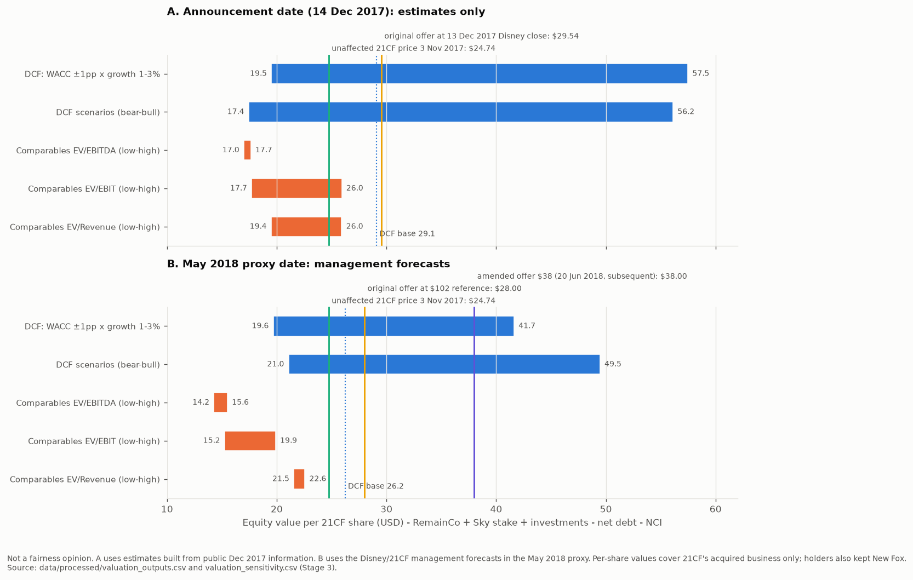

# Valuation report: Disney / 21st Century Fox (Stage 3)

*Standalone value of the acquired business (RemainCo), comparables and transaction analysis. No synergies,
accretion/dilution or real options. Method and sources: [`valuation_methodology.md`](valuation_methodology.md).
Every figure here is a row in `data/processed/valuation_outputs.csv`, `valuation_sensitivity.csv`,
`dcf_assumptions.csv` or `comparable_companies.csv`. USD millions unless stated.*

> These are analytical estimates for a case study, built from public information. They are not a fairness opinion.
> Perspective A rests mostly on **estimates**. Perspective B rests on **management forecasts**, decomposed with estimates.

## 1. Results

### Standalone DCF (equity value per 21CF share, for the acquired business only)

| | A: 14 Dec 2017 | B: 30 May 2018 |
|---|---|---|
| WACC | 6.04% | 6.86% |
| Terminal growth | 2.0% | 2.0% |
| Enterprise value of operations (incl. RSNs) | **57,603** | **51,449** (Disney forecasts) / 69,168 (21CF forecasts) |
| PV of terminal value, share of EV | 84% | 62% (Disney) / 85% (21CF) |
| + Sky 39% stake (estimate, at offer prices) | 10,389 | 12,018 |
| + other investments (book) | 727 | 606 |
| − debt / + cash | −19,849 / +6,901 | −19,997 / +6,772 |
| − noncontrolling interests | −1,951 | −1,787 |
| **Equity value** | **53,820** | **49,061** / 66,781 |
| **Per 21CF share** | **$29.08** | **$26.22** / $35.69 |
| Scenarios bear – base – bull (per share) | $17.40 – $29.08 – $56.17 | $21.03 – $26.22 – $49.51 |
| WACC ±1pp × g 1–3% (per share) | $19.46 – $57.52 | $19.64 – $41.68 |

For comparison: the unaffected 21CF price was **$24.74** (3 Nov 2017). The original offer was worth **$28.00** at Disney's
$102 reference price and **$29.54** at the 13 Dec 2017 close. The amended offer (20 Jun 2018, after B) was **$38.00**.

### Comparables (EV of operations → same bridge; Comcast and AMC Networks only)

| Per 21CF share | A (FY2017 metrics) | B (FY2017 pro forma metrics) |
|---|---|---|
| EV/EBITDA (A 8.04–8.35x; B 7.05–7.65x) | $17.0 – $17.7 | $14.2 – $15.6 |
| EV/EBIT | $17.7 – $26.0 | $15.2 – $19.9 |
| EV/Revenue | $19.4 – $26.0 | $21.5 – $22.6 |
| P/E | not applied (no public RemainCo earnings) | not meaningful (TCJA in peer LTM earnings) |
| Reference: advisors' 8.0–9.0x CY2018E EBITDA (proxy p.149) | n/a | EV 36,048 – 40,554 |

The peer multiples sit well below the DCF and the offer. The two usable peers are a cable-heavy conglomerate and a
small pure-play network group, and neither holds a studio of 20th Century Fox's scale or an international franchise
like Star India. Read the comparables as a floor and a sense check, not as the primary value.

### Transaction

| | Original (Dec 2017) | Amended (Jun 2018) | Closing (Mar 2019) |
|---|---|---|---|
| Per original 21CF share, Disney consideration | $28.00 (at $102) / $29.54 (13 Dec close) | $38.00 | $38.00 ($51.572626 × 0.736817) |
| Premium vs unaffected $24.74 (consideration only) | 13.2% / 19.4% | 53.6% | 53.6% |
| Package incl. 1/3 Fox Corporation share ($40.34) | n/a | n/a | $51.45 → **108%** nominal premium |
| Headline equity value | 52,400 | 71,300 | ~71,000 market-implied |
| Headline transaction (enterprise) value | 66,100 | 85,100 | ~71,000 (release); 70,400 derived |
| Cash / stock | 0 / all stock | 35,700 / 35,600 | 35,700 / ~35,000 |
| Accounting purchase price (ASC 805) | n/a | n/a | **69,507** (stock at $110.00) |
| Implied EV of operations / RemainCo EBITDA | 12.6x (A FY2017 estimate) | 17.6x FY2017 pro forma; 16.1x FY2018E | 16.9x FY2018 (closing perimeter) |

* The original offer ($28.00–$29.54) sat almost exactly on the A base DCF ($29.08). It was above the B base DCF ($26.22),
  which uses Disney's own forecasts, and inside both DCF sensitivity ranges.
* The amended $38 offer is above every B base case, but within the B bull and 21CF-forecast cases ($35.69 with 21CF's
  forecasts; $49.51 bull). A buyer paying it needed either 21CF's more optimistic forecasts or synergies. Disney guided
  to at least $2bn of cost synergies, which are not valued here.
* EV/EBITDA rose from ~12.6x (original) to ~16–18x (amended and closing). Over the same period peer multiples fell
  (Comcast 8.35x → 7.05x). The rise reflects the competitive bidding with Comcast, not a rerating of the sector.

## 2. Key assumptions (all in `dcf_assumptions.csv` with source and availability date)

* **A:** base FY2017 RemainCo revenue 18,500 and EBITDA 4,373 (derived from 21CF's 10-K less New Fox's ~$10bn /
  ~$2.8bn in the 14 Dec 2017 release); growth 3.0%; flat 23.6% EBITDA margin; D&A 1.94%, capex 1.25% and content
  investment 2.95% of revenue; tax 36%.
* **B:** Disney forecasts for RemainCo FY2018E–FY2028E (May 2018 proxy p.129) as disclosed. The decomposition into
  D&A (2.01%), 22% tax, capex (1.25%) and a working-capital residual is an estimate and does not change FCFF.
  Terminal conversion is 0.515 of EBITDA.
* **WACC:** dated FRED and Damodaran inputs; peer betas computed from Yahoo prices; the cost of debt is the Baa yield.
* **Bridge:** Sky valued at offer prices (estimate); other investments at book; RSNs inside EV.

## 3. Sensitivity findings

* **Terminal assumptions dominate A.** The terminal value is 84% of EV; at a 6.04% WACC, each 0.5pp of g moves the
  equity value by about $2.4–5.1 per share (larger at higher g). B (Disney case) is less sensitive (TV 62%) because the forecasts run to 11 years.
* **WACC:** ±0.5pp moves A by about −$3.4 / +$4.4 per share and B by about −$2.5 / +$3.1 (at g 2%).
* **Operating levers (per share, ±1pp):** EBITDA margin ≈ ±$1.7 (A) / ±$1.5 (B); revenue growth ≈ ±$1.4 (A) /
  −$2.4 / +$2.6 (B, compounding over 11 years); capex or content investment ≈ ∓$1.3 (A) / ∓$1.2 (B).
* **Which forecast set matters most in B:** 21CF's own forecasts give $35.69 against $26.22 for Disney's. Adding the
  estimated TCJA cash-tax uplift to Disney's forecasts gives $33.00.

## 4. Limitations

1. **A is estimate-driven.** No RemainCo financials or forecasts were public on 14 Dec 2017. The New Fox figures
   are rounded ("approximately $10bn / $2.8bn"). Compared with the pro forma published later, A's base revenue was
   about 4% low and its EBITDA (OIBDA basis) about 6% high. That comparison is hindsight, shown only for calibration.
2. **The forecasts don't break out the cash-flow components.** Neither proxy gives EBIT, D&A, capex, taxes or working
   capital separately. B's decomposition is an estimate, and it is unknown whether the forecasts embed pre-TCJA taxes.
3. **RSNs cannot be separated ex ante.** They are inside EV in both perspectives; the illustrative hindsight
   deduction is ~$11bn (Aug 2019 sale price).
4. **Investments are at book.** Hulu's 30% is understated, given that Disney's own 30% stake was valued at about
   $4.7bn at closing. The Sky stake is an estimate from offer prices; it actually sold for $15.1bn in Oct 2018,
   which is $4.7bn above the A estimate and $3.1bn above B.
5. **Thin peer set** (two usable peers), share-count proxy, no forward multiples, B metrics about 11 months stale.
6. **The cost of debt is a Baa index,** not 21CF's own bond yields. ERP availability dates are approximate
   (Damodaran publishes in January).
7. **Corporate costs and perimeter.** RemainCo carries all 21CF corporate costs (New Fox's standalone costs are
   estimated at $275–350m a year) and the RSNs that were later sold, as documented in Stage 2.
8. **Premiums are nominal.** The 16 months to closing include general market movement; no market adjustment was made.

## 5. Validation

All checks in `verification_checks.csv` pass. Stage 1/2 checks: 204 arithmetic tie-outs, 376 XBRL cross-checks,
82 quote checks, 14 allocation-table checks and 16 derived figures, all unchanged. Stage 3 adds checks for forecast
extraction (14), FCFF identities, WACC, terminal value, EV and bridge arithmetic, sensitivity direction, look-ahead,
input quotes and tables, and the market-data cross-check against proxy prices.

## 6. Readiness for the next stage

The standalone value of the acquired business is in place on both dates, with dated inputs, a full bridge and tested
mechanics. That is the base that **synergy valuation** needs (synergies would be valued as an increment over these
EVs). For **accretion/dilution**, inputs are still missing and need collecting: Disney's own forecasts (proxy pp.153–154),
the financing terms (bridge loans, the 307m shares issued), interest rates on the new debt, and purchase-accounting
amortization (in Disney's FY2019 10-K). See the summary at the end of the Stage 3 hand-off.
